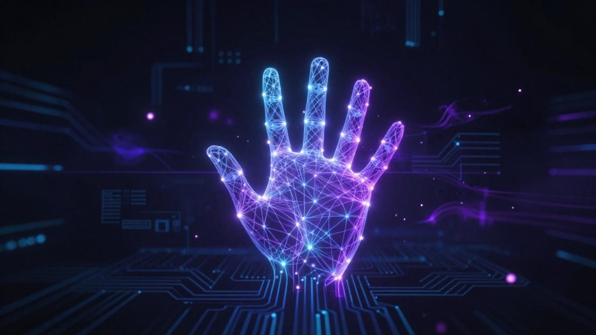
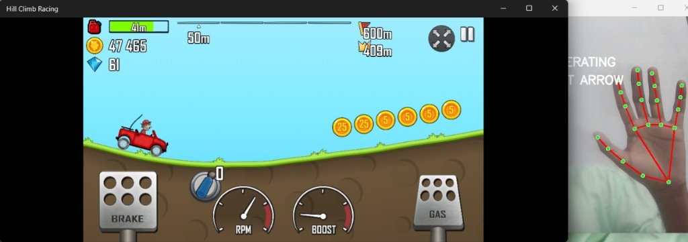
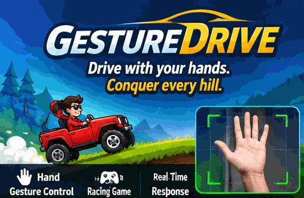

<div align="center">
  
</div>

<div align="center">
# GestureDrive

<em>Hand‑gesture controller for the classic Hill Climb Racing game (Python 3.12)</em>
</div>

---

<div align="center">
  
  
  
  
  
</div>

---

## Navigation
- [About](#about)
- [Features](#features)
- [Demo](#demo)
- [Screenshots](#screenshots)
- [Installation](#installation)
- [Usage](#usage)
- [Controls](#controls)
- [Project Structure](#project-structure)
- [Future Improvements](#future-improvements)
- [Credits](#credits)
- [License](#license)

---

## About
GestureDrive is a **Python‑based** computer‑vision application that lets you control the classic *Hill Climb Racing* game using hand gestures captured from a standard webcam. It detects a right hand, recognises **open‑palm** (accelerate) and **closed‑fist** (brake) gestures, and translates them into keyboard presses in real‑time.

---

## Features
| Feature | Description |
|---|---|
| Real‑time webcam hand detection | Captures frames at up to 30 FPS and mirrors the preview for intuitive control. |
| MediaPipe hand tracking | Utilises MediaPipe Hands (v0.10.21) for robust 21‑point landmark detection. |
| Open‑palm & closed‑fist recognition | Simple geometry‑based classification, independent of hand rotation. |
| Gesture smoothing & stability | Majority‑vote smoothing over recent frames to eliminate flicker. |
| Keyboard control integration | `pyautogui` wrapper sends `right` (accelerate) and `left` (brake) keys. |
| Game‑window focus detection | Optional Windows API check (`win32gui`) sends keys only when the game window is focused. |
| Tkinter dashboard | Live preview, calibration wizard, status overlay, and emergency‑stop button. |
| Emergency stop | Press **E** (or click the dashboard button) to instantly release all keys. |
| FPS monitoring | On‑screen FPS counter helps evaluate performance. |

---

## Demo
<a href="assets/demo/gesturedrive-promo.mp4">
  
</a>

[Watch GestureDrive Demo (MP4)](assets/demo/gesturedrive-promo.mp4)

---

## Screenshots



---

## App Icon


---

## Installation
```powershell
# Clone the repository (or copy the folder)
git clone https://github.com/Alby2442/GestureDrive.git
cd GestureDrive

# (Optional) Create a virtual environment
python -m venv venv
.\\venv\\Scripts\\Activate   # PowerShell
# or venv\\Scripts\\activate.bat for CMD

# Install dependencies
python -m pip install --upgrade pip
python -m pip install -r requirements.txt
```
You can verify the environment with the helper script:
```powershell
python check_install.py   # should end with "All good."
```

---

## Usage
```powershell
python main.py
```
- The webcam preview window appears.
- Press **S** to toggle control on/off.
- Press **E** for emergency stop.
- Press **ESC** to quit.
- The dashboard allows calibration and toggling of control.

---

## Controls
| Gesture / Key | Keyboard key | Action |
|---|---|---|
| **Open palm** | `right` | Accelerate (hold) |
| **Closed fist** | `left` | Brake (hold) |
| **No recognised gesture** | – | Release all controls |
| **`S`** | – | Toggle control on/off |
| **`E`** | – | Emergency stop – release every key |
| **`ESC`** | – | Exit the application |

*Key bindings can be customised in `config.py` or `settings.json`.*

---

<a id="project-structure"></a>
## Project Structure
```text
GestureDrive/                # repository root
├── main.py                # entry point
├── config.py              # default settings & loader
├── requirements.txt
├── README.md
├── .gitignore            # (added by this guide)
├── modules/               # core logic
│   ├── camera.py
│   ├── hand_detection.py
│   ├── hand_utils.py
│   ├── gesture_recognition.py
│   ├── keyboard_controller.py
│   └── …
├── assets/                # visual assets (all tracked)
│   ├── branding/          # original assets
│   │   └── gesturedrive-banner.png
│   ├── icons/             # original assets
│   │   └── app_icon.png
│   ├── demo/              # demo video
│   │   └── gesturedrive-promo.mp4
│   ├── screenshots/       # final screenshots
│   │   ├── dashboard.png
│   │   └── gesture-control.png
│   └── generated/          # generated assets (not used in final README)
│       ├── banner.png
│       ├── icon.png
│       ├── dashboard.gif
│       └── gesture-control.png
├── tests/                 # unit / integration tests
│   └── …
└── utils/                # helpers
    └── …
```

---

## Future Improvements
- Custom key‑mapping profiles (per‑game).
- Lightweight CLI mode (no GUI).
- Tilt‑based steering (forward/backward keys).
- Single‑file executable distribution.

---

## Credits
- **Author:** Albin Saji
- **MediaPipe** – Google’s cross‑platform ML solutions.
- **OpenCV** – Open‑source computer‑vision library.
- **PyAutoGUI** – Keyboard‑automation library.
- **Tkinter** – Standard Python GUI toolkit.

---

## License
No license has been specified for this project yet.
